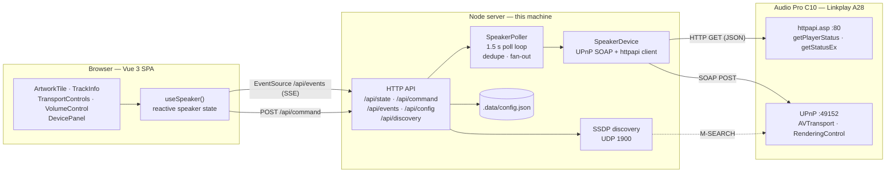
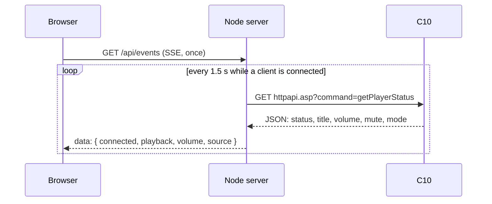
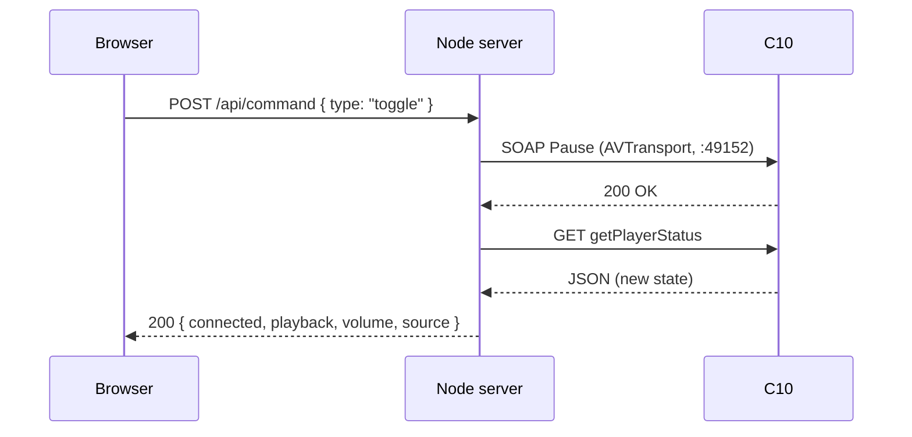

# C10 Control

[](https://github.com/vampaz/c10-control/actions/workflows/ci.yml)

A local companion app for the **Audio Pro C10** Wi-Fi speaker. It replaces the vendor app with a fast, quiet web remote that runs on your own machine.

## What the speaker is

Discovered from the device itself on the LAN:

| | |
| --- | --- |
| Platform | Linkplay **A28** module (Wiimu) |
| Firmware | `4.2.337151`, build `a28audiopro`, branch `stable/wiimu-4.2` |
| Built | 2021-11-30 |
| Control surfaces | `httpapi.asp` on port 80, UPnP on port 49152 |
| Services | UPnP MediaRenderer, AirPlay, Spotify Connect, QPlay, Linkplay multiroom |

The vendor firmware is a closed Linkplay build, so this project leaves it alone and drives it from the outside: no flashing, no risk of a brick.

## Architecture

Three layers. The browser never talks to the speaker directly, and the server owns all device state.



### Why the server exists

The UI could not do this alone: `httpapi.asp` sends no CORS headers, SSDP needs raw UDP, and a browser cannot keep one shared poll loop across tabs. The Node process solves all three and stays dependency-free.

### Components

| Path | Responsibility |
| --- | --- |
| `server/runtime.ts` | Builds the API, the poller and the speaker client; shared by both entry points |
| `server/app.ts` | Routes, JSON bodies, Server-Sent Events |
| `server/state.ts` | `SpeakerPoller`: polls while clients are connected, collapses overlapping polls, marks the speaker offline after two misses, fans state out to subscribers |
| `server/device.ts` | `SpeakerDevice`: one method per speaker action, all HTTP and SOAP details |
| `server/soap.ts` | SOAP envelope builder and response/fault parser |
| `server/status.ts` | `getPlayerStatus` payload parsing, hex text decoding, source and input labels |
| `server/mediainfo.ts` | `GetMediaInfo` DIDL parsing: cover art, subtitle and current URI |
| `server/discovery.ts` | SSDP M-SEARCH that maps responders to their UPnP description |
| `server/config.ts` | Address, library and media-URL validation, `.data/config.json` persistence |
| `server/network.ts` | Picks the local address the speaker can reach for library files |
| `server/didl.ts` | Builds the DIDL-Lite metadata sent with a pushed URI |
| `server/radio.ts` | Station search against radio-browser.info, with caching |
| `server/favorites.ts` | Favorite stations in `.data/favorites.json` |
| `server/presets.ts` | Six preset slots in `.data/presets.json` |
| `server/playlists.ts` | Named playlists in `.data/playlists.json` |
| `server/library.ts` | Multi-folder index, safe path resolution and Range streaming |
| `server/queue.ts` | App-side queue and auto-advance |
| `server/sleep.ts` | Sleep timer with fade-out and volume restore |
| `src/components/BrowsePanel.vue` | Station search, favorites and the custom-URL player |
| `src/composables/useSpeaker.ts` | One reactive state object for the UI, command dispatch |
| `src/api.ts` | Thin `fetch`/`EventSource` wrapper for the endpoints above |

### Read path

One poll feeds every viewer:



### Write path

Commands go straight through the same connection and the UI gets the result immediately, then the fresh state:



## Requirements

- Node.js 24 or newer
- The speaker and this machine on the same network

## Quick start

```sh
npm install
npm run dev
```

Open <http://localhost:5173>, press the gear, and enter the speaker address (for example `192.168.1.100`). The address is stored in `.data/config.json`.

### Production mode

```sh
npm run build
npm start          # http://localhost:8787
```

### Docker

For an always-on machine on your network:

```sh
cp .env.example .env      # set C10_HOST and C10_MUSIC_DIR
docker compose up -d --build
```

Open `http://<server>:8787`. The container restarts with the host, keeps the address chosen in the settings dialog in the `c10-data` volume, reads music from `${C10_MUSIC_DIR}` (default `./music`), and answers its own health check at `/api/health`.

The image is a two-stage build: Node builds the UI, then the runtime stage carries only `server/`, `shared/` and `dist/`. There is no `node_modules` in the runtime image, because the server uses only Node built-ins and runs TypeScript through Node's type stripping.

| | |
| --- | --- |
| Base image | `node:24-alpine`, multi-stage |
| Port | `8787` |
| Volume | `c10-data` → `/data/config.json` |
| Music | host folder → `/music`, read-only |
| Health check | `GET /api/health`, every 30 s |
| Restart policy | `unless-stopped` |

#### Configuration order

The address resolves in this order, last one wins:

1. Built-in default (`192.168.1.100`)
2. Value saved in the settings dialog, stored in `/data/config.json`
3. `C10_HOST`, `C10_HTTP_PORT`, `C10_UPNP_PORT`, `C10_LIBRARY_DIR`, `C10_LIBRARY_DIRS`, `C10_MEDIA_URL`

Environment variables therefore always apply, which is what a container deployment expects. While `C10_HOST` is set, the settings dialog shows the address as read-only and the API rejects a conflicting save, so nothing is silently overridden. The library folder and media URL can still be changed there.

#### Networking

Outbound TCP to the speaker works on the default bridge network, so the app is fully usable there. **SSDP discovery needs multicast, which a bridge network does not carry**: with bridge networking `/api/discovery` returns an empty list even though the speaker is reachable. On a Linux host, use host networking:

```yaml
    network_mode: host
    # and remove the `ports:` block, host mode publishes the port directly
```

On Docker Desktop (macOS, Windows) discovery stays unavailable; enter the address in the settings dialog or set `C10_HOST`.

**Local library on bridge networking:** the speaker fetches files from the app, and the container's bridge address is not reachable from the speaker. Set `C10_MEDIA_URL=http://<host-lan-ip>:8787` in `.env`. With host networking the app can detect the right address by itself.

### Configuration

| Variable | Default | Meaning |
| --- | --- | --- |
| `C10_HOST` | `192.168.1.100` | Speaker address |
| `C10_HTTP_PORT` | `80` | `httpapi.asp` port |
| `C10_UPNP_PORT` | `49152` | UPnP control port |
| `C10_LIBRARY_DIR` | empty | One folder scanned for local audio |
| `C10_LIBRARY_DIRS` | empty | Comma-separated folders, adds several libraries |
| `C10_MEDIA_URL` | auto | Base URL the speaker uses for local files |
| `PORT` | `5173` dev, `8787` start | Port this app listens on |
| `C10_DATA_DIR` | `.data` | Where the saved configuration lives |

`C10_HOST`, `C10_HTTP_PORT` and `C10_UPNP_PORT` also let you point the app at a proxy or a test double.

## Features

- **Browse and play radio** — search a directory of stations and play them on the speaker
- **Play any stream or file URL** — paste a URL, the speaker starts it
- **Favorites** — saved on the server, one tap to play
- **Local libraries** — add one or more folders, search them, play files and seek
- **Playlists** — create, rename, delete, add the current track, play the list through the queue
- **Queue** — play library tracks one after another, with next and previous
- **Six presets** — save the current track into a slot and play it later
- **Sleep timer** — fade out over the last 20 seconds, then pause
- **Input switching** — Wi-Fi, Bluetooth, Aux and Optical
- Live now playing: title, artist, album, subtitle and real cover art from the speaker's DIDL metadata
- Transport: play, pause, next, previous, seek when the source reports a duration
- Volume and mute
- Connection state, with the speaker's own error text when a command fails
- Automatic reconnect; the UI recovers by itself after a network drop
- Keyboard: `Space` play/pause, `↑`/`↓` volume, `←`/`→` seek, `M` mute
- Speaker discovery over SSDP, with manual address entry as the fallback
- Responsive layout for desktop and phone widths, reduced-motion support

## How it talks to the speaker

- `http://<speaker>/httpapi.asp?command=getPlayerStatus` for playback state, volume, mute and source mode; `getStatusEx` for the device name, model and firmware. `curpos` and `totlen` are milliseconds, and local files report `status: "none"` while they play.
- SOAP over UPnP on `http://<speaker>:49152/upnp/control/rendertransport1` for `Play`, `Pause`, `Stop`, `Next`, `Previous`, `Seek`, `SetAVTransportURI` when the app starts something new, and `GetMediaInfo` for cover art, subtitle and the current URI.
- SOAP over UPnP on `http://<speaker>:49152/upnp/control/rendercontrol1` for `SetVolume` and `SetMute`.
- `http://<speaker>/httpapi.asp?command=setPlayerCmd:switchmode:<input>` for Wi-Fi, Bluetooth, Aux (`line-in`) and Optical.

This firmware answers `unknown command` for many `httpapi.asp` commands (`setVolume`, `getMute`, presets and most `setPlayerCmd` variants), so control goes through UPnP, which is fully implemented. `switchmode` is the exception.

To start playback the app sends `SetAVTransportURI` with a generated DIDL-Lite document (title, artwork, media class) and then `Play`. Passing the metadata matters: without it the speaker shows the raw URL as the track title.

Local library files are served by this app at `/api/library/file` with `Range` support, and the speaker fetches that URL itself. The URL therefore has to use a LAN address, not `localhost`; `C10_MEDIA_URL` overrides the detected address.

Station search uses [radio-browser.info](https://www.radio-browser.info/), a free directory that needs no API key. HLS-only entries are filtered out because this firmware cannot play them, and favourite URLs are de-duplicated.

## HTTP API

| Method | Path | Purpose |
| --- | --- | --- |
| `GET` | `/api/state` | Current speaker state |
| `GET` | `/api/events` | Server-Sent Events stream of state changes |
| `POST` | `/api/command` | `play`, `pause`, `toggle`, `next`, `previous`, `stop`, `seek`, `volume`, `mute`, `input` |
| `POST` | `/api/play` | Push `{ url, title?, artworkUrl?, isLive? }` to the speaker |
| `GET` | `/api/radio/search?q=` | Search stations |
| `GET` | `/api/favorites` | List favorites |
| `POST` | `/api/favorites` | Save a station |
| `DELETE` | `/api/favorites/:id` | Forget a station |
| `GET` | `/api/presets` | List the six preset slots |
| `PUT` | `/api/presets/:index` | Save a track into a slot |
| `DELETE` | `/api/presets/:index` | Clear a slot |
| `GET` | `/api/sleep` | Current sleep deadline |
| `POST` | `/api/sleep` | Start `{ minutes }` |
| `DELETE` | `/api/sleep` | Cancel the timer |
| `GET` | `/api/library` | Indexed files with speaker-ready URLs, `?q=&library=&limit=&offset=` |
| `GET` | `/api/library/file?library=&path=` | Stream a file, with Range support |
| `GET` | `/api/playlists` | List playlists |
| `POST` | `/api/playlists` | Create `{ name }` |
| `PUT` · `DELETE` | `/api/playlists/:id` | Rename or delete |
| `POST` | `/api/playlists/:id/items` | Add a track |
| `DELETE` | `/api/playlists/:id/items/:itemId` | Remove a track |
| `POST` | `/api/playlists/:id/current` | Add the current track |
| `POST` | `/api/playlists/:id/play` | Load into the queue and play |
| `GET` | `/api/queue` | Queue and active index |
| `POST` | `/api/queue` | Add a track |
| `DELETE` | `/api/queue` | Clear the queue |
| `DELETE` | `/api/queue/:id` | Remove a track |
| `POST` | `/api/queue/play` | Play `{ index }` |
| `POST` | `/api/queue/next` · `previous` | Move through the queue |
| `GET` | `/api/config` · `PUT` | Speaker address, libraries, media URL |
| `GET` | `/api/discovery` | SSDP search |
| `GET` | `/api/health` | Health check |

## Data files

| Path | Contents |
| --- | --- |
| `.data/config.json` | Speaker address, library folder and media URL, when set from the settings dialog |
| `.data/favorites.json` | Favorite stations |
| `.data/presets.json` | Six preset slots |
| `.data/playlists.json` | Named playlists and their tracks |

Inside the container both live in the `c10-data` volume at `/data`.

## Limits

- **Push is not available.** The speaker exposes no event stream this app can use, so the server polls every 1.5 s while a client is connected and hands the result to the browser over Server-Sent Events.
- **No authentication.** The speaker API is unauthenticated on the LAN, and so is this app. Do not expose either to the internet.
- **Source labels are partly inferred.** Only mode 10 (`Wi-Fi`, internet radio) and mode 2 (a pushed stream) were observed on this unit; the other mode codes follow the Linkplay convention and are unverified here.
- **Multiroom grouping is not implemented.** `multiroom:getSlaveList` answers with a count, but the join and leave commands are undocumented and could not be verified with a single speaker. The app does not ship untested group actions.
- **Plex is not implemented yet.** Plex's media API answers `401` without an `X-Plex-Token`, even on the LAN; the iOS app signs in once and stores one. A link-code sign-in is possible, but folder libraries and playlists were the priority.
- **The queue is in memory.** Restarting the server clears it; the speaker keeps playing the current track.
- **Library scans are cached for five minutes.** New files appear after the cache expires or after a restart.
- **Local files need a speaker-reachable URL.** The speaker fetches the file itself, so `localhost` will not work. The app detects an address on the speaker's subnet, and `C10_MEDIA_URL` overrides it for Docker bridge networks.
- **Sleep timer, presets and playlists are app-side.** They run in this server, not on the speaker, and stop if the server stops.
- **Discovery needs multicast.** If SSDP is blocked on your network, or the app runs in a Docker bridge network, enter the address by hand or set `C10_HOST`.
- **Radio search needs outbound HTTPS** to `de1.api.radio-browser.info`. Playback itself only needs the speaker to reach the stream.

## Scripts

| Command | What it does |
| --- | --- |
| `npm run dev` | Vite in middleware mode plus the API on one port |
| `npm run build` | Builds the UI into `dist/` |
| `npm start` | Serves the built UI and the API |
| `npm run lint` | ESLint, flat config |
| `npm run typecheck` | `vue-tsc --noEmit` |
| `npm test` | Vitest |

## Layout

```
Dockerfile          multi-stage image (build UI, then runtime)
docker-compose.yml  container definition: port, volume, env, health
.env.example        C10_HOST template for compose
server/
  index.ts        production entry point (static files + API)
  dev.ts          dev entry point (Vite middleware + API)
  runtime.ts      shared wiring for both entry points
  app.ts          HTTP routes, JSON, SSE
  state.ts        polling and state fan-out
  device.ts       speaker actions (UPnP + httpapi)
  soap.ts         SOAP build/parse
  didl.ts         metadata for pushed streams
  status.ts       getPlayerStatus parsing, text decoding
  mediainfo.ts    GetMediaInfo DIDL parsing: artwork, subtitle, URI
  radio.ts        station search and caching
  favorites.ts    favorite stations
  presets.ts      six preset slots
  playlists.ts    named playlists and their tracks
  library.ts      multi-folder index, path safety, Range streaming
  queue.ts        app-side queue and auto-advance
  sleep.ts        sleep timer with fade-out
  network.ts      local address detection for library URLs
  discovery.ts    SSDP search
  config.ts       address validation and persistence
  static.ts       built-UI file serving
src/              Vue 3 UI
shared/           types used by both sides
tests/            unit and component tests
```

## License

MIT. See [LICENSE](LICENSE).
