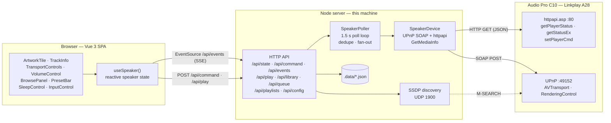
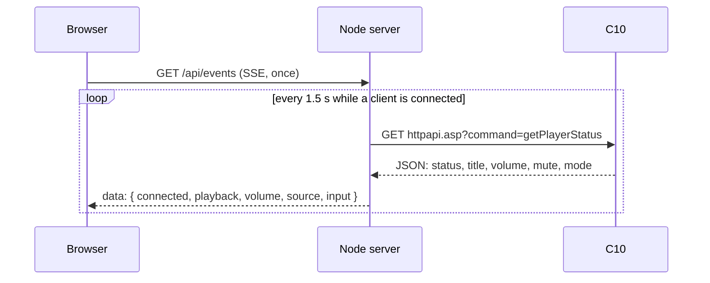
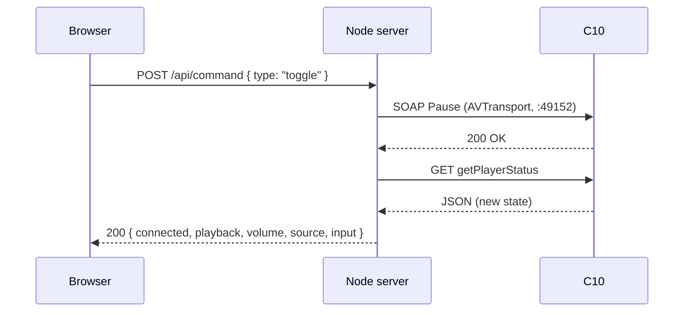

# C10 Control — technical documentation

This document covers the architecture, protocols, API and internals. For installation and everyday use, see the [README](../README.md).

## Tested hardware

The app was built and tested against an Audio Pro C10 with the Linkplay A28 module. These details come from the speaker's own status endpoints:

| | |
| --- | --- |
| Platform | Linkplay **A28** module (Wiimu) |
| Firmware | `4.2.337151`, build `a28audiopro`, branch `stable/wiimu-4.2` |
| Built | 2021-11-30 |
| Control surfaces | `httpapi.asp` on port 80, UPnP on port 49152 |
| Services | UPnP MediaRenderer, AirPlay, Spotify Connect, QPlay |

The speaker runs closed Linkplay firmware. The app does not modify it; it drives the HTTP and UPnP interfaces from outside, so there is no flashing and no risk of bricking the device. Linkplay multiroom is advertised by the firmware but is not used by this app.

## Architecture

Three layers. The browser never talks to the speaker directly, and the server owns all device state.



### Why the server exists

The UI could not do this alone: `httpapi.asp` sends no CORS headers, SSDP needs raw UDP, and a browser cannot keep one shared poll loop across tabs. The Node process solves all three; it uses Node built-ins plus `sharp` for cover thumbnails.

### Components

| Path | Responsibility |
| --- | --- |
| `server/runtime.ts` | Builds the API, the poller and the speaker client; shared by both entry points |
| `server/app.ts` | Routes, JSON bodies, Server-Sent Events |
| `server/state.ts` | `SpeakerPoller`: polls while clients are connected, collapses overlapping polls, marks the speaker offline after two misses, fans state out to subscribers |
| `server/device.ts` | `SpeakerDevice`: one method per speaker action, all HTTP and SOAP details |
| `server/soap.ts` | SOAP envelope builder and response/fault parser |
| `server/status.ts` | `getPlayerStatus` payload parsing, hex text decoding, source and input labels |
| `server/mediainfo.ts` | `GetMediaInfo` DIDL parsing: cover art, subtitle and current URI |
| `server/discovery.ts` | SSDP M-SEARCH that maps responders to their UPnP description |
| `server/config.ts` | Address, library and media-URL validation, `.data/config.json` persistence |
| `server/network.ts` | Picks the local address the speaker can reach for library files |
| `server/didl.ts` | Builds the DIDL-Lite metadata sent with a pushed URI |
| `server/radio.ts` | Station search against radio-browser.info, with caching |
| `server/favorites.ts` | Favorite stations in `.data/favorites.json` |
| `server/presets.ts` | Six preset slots in `.data/presets.json` |
| `server/playlists.ts` | Named playlists in `.data/playlists.json` |
| `server/library.ts` | Multi-folder index, safe path resolution, Range streaming, cover art, folder playback and tag lookup |
| `server/tags.ts` | FLAC, ID3 and MP4 text tag reader |
| `server/thumbs.ts` | Square WebP cover thumbnails through sharp |
| `server/folders.ts` | Read-only directory listing for the settings folder browser |
| `server/queue.ts` | App-side queue and auto-advance |
| `server/sleep.ts` | Sleep timer with fade-out and volume restore |
| `src/components/BrowsePanel.vue` | Radio search, favorites, libraries, queue and playlists |
| `src/components/LibraryPanel.vue` | Album track list |
| `src/components/AlbumGrid.vue` | Album cards with cover art |
| `src/components/PlaylistsPanel.vue` | Playlist create, rename, delete and item management |
| `src/components/PresetBar.vue` | Six preset slots |
| `src/components/SleepControl.vue` | Sleep timer menu and countdown |
| `src/components/InputControl.vue` | Input selector |
| `src/composables/useSpeaker.ts` | One reactive state object for the UI, command dispatch |
| `src/api.ts` | Thin `fetch`/`EventSource` wrapper for the endpoints above |

### Read path

One poll feeds every viewer:



### Write path

Commands go straight through the same connection and the UI gets the result immediately, then the fresh state:



## How it talks to the speaker

- `http://<speaker>/httpapi.asp?command=getPlayerStatus` for playback state, volume, mute and source mode; `getStatusEx` for the device name, model and firmware. `curpos` and `totlen` are milliseconds, and local files report `status: "none"` while they play.
- SOAP over UPnP on `http://<speaker>:49152/upnp/control/rendertransport1` for `Play`, `Pause`, `Stop`, `Next`, `Previous`, `Seek`, `SetAVTransportURI` when the app starts something new, `GetMediaInfo` for cover art, subtitle and the current URI, and `GetTransportInfo` for the authoritative play state.
- SOAP over UPnP on `http://<speaker>:49152/upnp/control/rendercontrol1` for `SetVolume` and `SetMute`.
- `http://<speaker>/httpapi.asp?command=setPlayerCmd:switchmode:<input>` for Wi-Fi, Bluetooth, Aux (`line-in`) and Optical.

This firmware answers `unknown command` for many `httpapi.asp` commands (`setVolume`, `getMute`, presets and most `setPlayerCmd` variants), so control goes through UPnP, which is fully implemented. `switchmode` is the exception.

To start playback the app sends `SetAVTransportURI` with a generated DIDL-Lite document (title, artwork, media class) and then `Play`. Passing the metadata matters: without it the speaker shows the raw URL as the track title.

Local library files are served by this app at `/api/library/file` with `Range` support, and the speaker fetches that URL itself. The URL therefore has to use a LAN address, not `localhost`; `C10_MEDIA_URL` overrides the detected address.

Station search uses [radio-browser.info](https://www.radio-browser.info/), a free directory that needs no API key. HLS-only entries are filtered out because this firmware cannot play them, and favourite URLs are de-duplicated.

## HTTP API

| Method | Path | Purpose |
| --- | --- | --- |
| `GET` | `/api/state` | Current speaker state |
| `GET` | `/api/events` | Server-Sent Events stream of state changes |
| `POST` | `/api/command` | `play`, `pause`, `toggle`, `next`, `previous`, `stop`, `seek`, `volume`, `mute`, `input` |
| `POST` | `/api/play` | Push `{ url, title?, artworkUrl?, isLive? }` to the speaker |
| `GET` | `/api/radio/search?q=` | Search stations |
| `GET` | `/api/radio/top?limit=&offset=` | Most-played stations for browsing |
| `GET` | `/api/favorites` | List favorites |
| `POST` | `/api/favorites` | Save a station |
| `DELETE` | `/api/favorites/:id` | Forget a station |
| `GET` | `/api/presets` | List the six preset slots |
| `PUT` | `/api/presets/:index` | Save a track into a slot |
| `DELETE` | `/api/presets/:index` | Clear a slot |
| `GET` | `/api/sleep` | Current sleep deadline |
| `POST` | `/api/sleep` | Start `{ minutes }` |
| `DELETE` | `/api/sleep` | Cancel the timer |
| `GET` | `/api/library` | Indexed files with speaker-ready URLs, `?q=&library=&dir=&limit=&offset=` |
| `GET` | `/api/library/albums` | Album folders with track counts and cover art, `?q=&library=&limit=&offset=` |
| `GET` | `/api/library/file?library=&path=` | Stream a file, with Range support |
| `GET` | `/api/library/art?library=&path=` | Cover art from the file's tags or its album folder |
| `POST` | `/api/library/play` | Play `{ library, path }` or `{ library, dirs, shuffle? }` with the folder queued |
| `GET` | `/api/folders?path=` | List directories under the browse roots |
| `GET` | `/api/playlists` | List playlists |
| `POST` | `/api/playlists` | Create `{ name }` |
| `PUT` | `/api/playlists/:id` | Rename a playlist |
| `DELETE` | `/api/playlists/:id` | Delete a playlist |
| `POST` | `/api/playlists/:id/items` | Add a track |
| `DELETE` | `/api/playlists/:id/items/:itemId` | Remove a track |
| `POST` | `/api/playlists/:id/current` | Add the current track |
| `POST` | `/api/playlists/:id/play` | Load into the queue and play |
| `GET` | `/api/queue` | Queue and active index |
| `POST` | `/api/queue` | Add a track |
| `DELETE` | `/api/queue` | Clear the queue |
| `DELETE` | `/api/queue/:id` | Remove a track |
| `POST` | `/api/queue/play` | Play `{ index }` |
| `POST` | `/api/queue/next-up` | Insert a track after the active one |
| `POST` | `/api/queue/move` | Move `{ from, to }` positions |
| `GET` | `/api/speaker-queue` | Tracks in the device-side queue |
| `POST` | `/api/speaker-queue` | Send the app queue to the speaker and play it |
| `DELETE` | `/api/speaker-queue` | Remove the device-side queue |
| `POST` | `/api/queue/next` | Move forward in the queue |
| `POST` | `/api/queue/previous` | Move back in the queue |
| `PUT` | `/api/queue/mode` | Set `{ repeat, shuffle }` |
| `GET` | `/api/config` | Read the configuration |
| `PUT` | `/api/config` | Update the speaker address, libraries or media URL |
| `GET` | `/api/discovery` | SSDP search |
| `GET` | `/api/device` | Speaker signal, channel, internet and update state |
| `PUT` | `/api/device/name` | Rename the speaker with `{ name }` |
| `GET` | `/api/health` | Health check |

## Data files

| Path | Contents |
| --- | --- |
| `.data/config.json` | Speaker address, libraries and media URL, when set from the settings dialog |
| `.data/favorites.json` | Favorite stations |
| `.data/presets.json` | Six preset slots |
| `.data/playlists.json` | Named playlists and their tracks |
| `.data/queue.json` | Current queue, active track, repeat and shuffle |
| `.data/album-tags.json` | Album and artist tags per folder, rebuilt when a first track changes |
| `.data/positions.json` | Resume positions for finite tracks |
| `.data/thumbs/` | Cached WebP cover thumbnails |

All four live in the `c10-data` volume at `/data` inside the container. The `.data` directory is ignored by git. No library is configured by default: add folders in the settings dialog, or set `C10_LIBRARY_DIR` / `C10_LIBRARY_DIRS` as deployment defaults.

The settings folder browser lists directories under `C10_BROWSE_ROOTS` only. In the Docker compose file that root is `/host/music`, backed by the read-only `C10_MUSIC_ROOT` mount.

The library path is saved in `config.json`, but the folder contents are not. In Docker, bind-mount the folder; a path inside the container without a volume is lost when the container is recreated, leaving the saved library pointing at a missing folder.

## Limits

- **Push is not available.** The speaker exposes no event stream this app can use, so the server polls every 1.5 s while a client is connected and hands the result to the browser over Server-Sent Events.
- **No authentication.** The speaker API is unauthenticated on the LAN, and so is this app. Do not expose either to the internet.
- **Source labels are partly inferred.** Only mode 10 (`Wi-Fi`, internet radio) and mode 2 (a pushed stream) were observed on the test unit; the other mode codes follow the Linkplay convention and are unverified here.
- **Multiroom grouping is not implemented.** `multiroom:getSlaveList` answers with a count, but the join and leave commands are undocumented and could not be verified with a single speaker. The app does not ship untested group actions.
- **Plex is not implemented.** Plex's media API answers `401` without an `X-Plex-Token`, even on the LAN. A link-code sign-in is possible; folder libraries and playlists were the priority.
- **The queue is persisted.** `.data/queue.json` keeps the list, the active track, repeat and shuffle; the speaker keeps playing the current track while the server restarts.
- **Library scans are cached for five minutes.** New files appear after the cache expires or after a restart.
- **Local files need a speaker-reachable URL.** The speaker fetches the file itself, so `localhost` will not work. The app detects an address on the speaker's subnet, and `C10_MEDIA_URL` overrides it for Docker bridge networks. Docker compose mounts `C10_MUSIC_ROOT` read-only at `/host/music` and exposes it through the settings folder browser; paths outside that mount are not visible to the container.
- **Sleep timer, presets and playlists are app-side.** They run in this server, not on the speaker, and stop if the server stops.
- **Discovery needs multicast.** If SSDP is blocked on your network, or the app runs in a Docker bridge network, enter the address by hand or set `C10_HOST`.
- **Radio search needs outbound HTTPS** to `de1.api.radio-browser.info`. Playback itself only needs the speaker to reach the stream.

## Scripts

| Command | What it does |
| --- | --- |
| `npm run dev` | Vite in middleware mode plus the API on one port |
| `npm run build` | Builds the UI into `dist/` |
| `npm start` | Serves the built UI and the API |
| `npm run lint` | ESLint, flat config |
| `npm run typecheck` | `vue-tsc --noEmit` |
| `npm test` | Vitest |

GitHub Actions runs lint, typecheck, tests and build on every push and pull request.

## Layout

```
.github/workflows/ci.yml  lint, typecheck, tests and build on GitHub Actions
Dockerfile                multi-stage image (build UI, then runtime)
docker-compose.yml        container definition: port, volumes, env, health
.env.example              environment template for compose
LICENSE                   MIT
SECURITY.md               security notes for a LAN-only app
docs/                     user and technical documentation
public/                   favicon, PWA icons, manifest and service worker
server/
  index.ts        production entry point (static files + API)
  dev.ts          dev entry point (Vite middleware + API)
  runtime.ts      shared wiring for both entry points
  app.ts          HTTP routes, JSON, SSE
  state.ts        polling and state fan-out
  device.ts       speaker actions (UPnP + httpapi)
  soap.ts         SOAP build/parse
  didl.ts         metadata for pushed streams
  status.ts       getPlayerStatus parsing, text decoding
  mediainfo.ts    GetMediaInfo DIDL parsing: artwork, subtitle, URI
  radio.ts        station search and caching
  favorites.ts    favorite stations
  presets.ts      six preset slots
  playlists.ts    named playlists and their tracks
  library.ts      multi-folder index, path safety, Range streaming
  folders.ts      read-only directory listing for the folder browser
  queue.ts        app-side queue and auto-advance
  sleep.ts        sleep timer with fade-out
  network.ts      local address detection for library URLs
  discovery.ts    SSDP search
  config.ts       address and library validation, persistence
  static.ts       built-UI file serving
src/              Vue 3 UI
shared/           types used by both sides
tests/            unit and component tests
```
